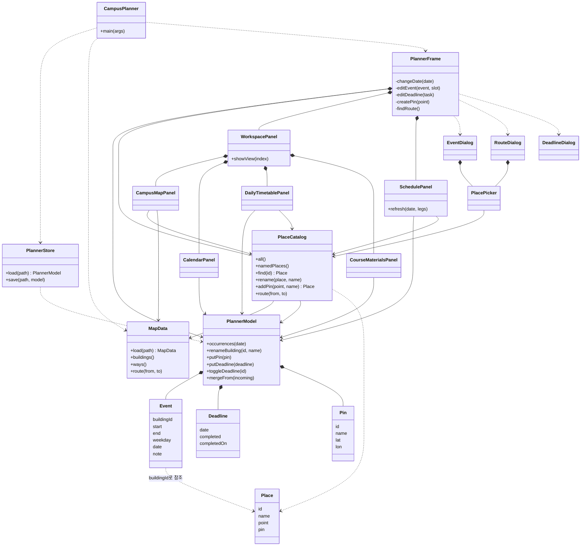

`PlannerFrame`은 화면 연결과 사용자 동작을 조정합니다. 일정과 개인 장소는 `PlannerModel`, XML 저장은 `PlannerStore`, OSM 지형과 보행 그래프는 `MapData`가 담당합니다.

도식의 `Event`, `Deadline`, `Pin`은 `PlannerModel` 안에 선언된 중첩 레코드입니다.

`Place`는 OSM 건물과 개인 핀을 공통으로 다룹니다. 일정의 기존 `buildingId` 필드에는 둘 중 어느 장소의 ID든 저장할 수 있습니다. 이름을 바꾸어도 ID와 일정 연결은 유지됩니다.

`PlaceCatalog`는 OSM 이름에 개인 이름을 적용하고 핀을 합칩니다. 왼쪽 목록에는 이름이 있는 장소만 제공합니다. 이름 없는 건물의 지도 도형은 남아 있어 선택하고 이름을 지정할 수 있습니다. OSM 원본 파일은 개인 이름이나 핀을 저장할 때 수정하지 않습니다.

길찾기는 `MapData`의 보행 그래프를 사용합니다. 핀도 가까운 보행로와 연결하며, 추정한 연결 구간은 안내에 표시합니다. 보행로까지 연결할 수 없는 지점은 경로 없음으로 처리합니다.

`WorkspacePanel`의 반투명 좌우 버튼으로 지도 → 달력 → 하루 시간표 → 과목 자료를 순환합니다. 오른쪽 `SchedulePanel`은 선택한 날짜의 일정, 일정 사이 도보 거리와 시간, 과제와 메모를 표시합니다.

달력과 오른쪽 일정의 과제는 같은 `Deadline`을 사용합니다. 미제출 마감일은 빨간색으로, 제출완료 상태는 회색으로 표시합니다. 제출 버튼을 누른 날짜를 `completedOn`에 저장하여 이후 수정이나 재실행에도 제출 날짜를 유지합니다.

과목 자료 화면은 매주 반복되는 수업을 과목 이름으로 묶습니다. 버튼을 누르면 앱 폴더의 `materials/과목명` 폴더를 만들고 파일 탐색기로 엽니다. Windows에서 사용할 수 없는 이름은 안전하게 변환하고 이름 충돌을 구분하는 짧은 값을 붙입니다. 강의 자료 파일은 해당 폴더에서 직접 관리합니다.

`PlannerStore`는 이전 XML `version="1"`과 현재 `version="2"`를 모두 읽습니다. 기존 일정, 휴강 예외, 즐겨찾기와 메모를 유지하며 다음 저장부터 버전 2로 기록합니다. 버전 2는 개인 건물 이름, 핀, 과제와 제출 날짜를 추가합니다. 임시 파일 작성 후 교체하고, 잘못된 형식이나 지원하지 않는 버전은 오류로 알립니다.

공유 XML에는 일정, 과제, 개인 장소 이름, 핀, 즐겨찾기와 모든 메모가 포함됩니다. `materials` 안의 강의 자료 파일과 OSM 파일은 포함되지 않습니다. 공유할 때 파일에 들어가는 개인 메모도 함께 확인해야 합니다.

가져오기는 읽기에 성공한 뒤 사용자가 확인하면 `PlannerModel.mergeFrom`으로 합칩니다. 같은 내용은 중복 생성을 피하고, 같은 ID에 다른 내용이 있으면 새 ID를 부여합니다. 가져온 일정의 핀 참조와 휴강 예외도 새 ID에 맞춥니다. 기존 개인 장소 이름을 우선하며, 서로 다른 날짜별 메모는 함께 보존합니다.
