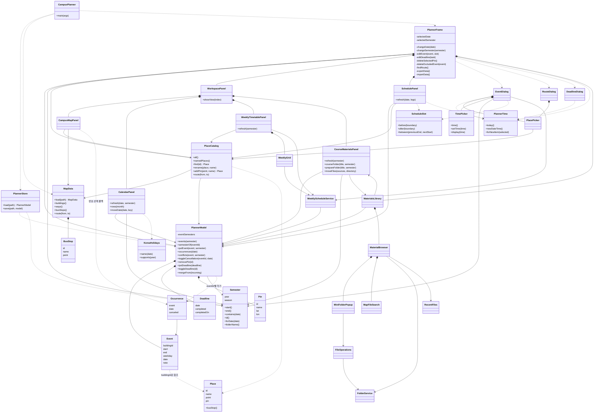

`PlannerFrame`은 날짜·학기 선택과 화면 연결을 조정합니다. 일정과 개인 장소는 `PlannerModel`, XML 저장은 `PlannerStore`, OSM 지형과 보행 그래프는 `MapData`가 담당합니다. `Event`, `Occurrence`, `Deadline`, `Pin`은 `PlannerModel`의 중첩 레코드이며, `Semester`는 독립 레코드입니다.

`Place`는 OSM 건물·버스정류장·개인 핀을 공통으로 다룹니다. 일정의 `buildingId`는 장소 ID를 참조하므로 정류장이나 핀도 일정과 최단거리 검색에 사용할 수 있습니다. `MapData`는 OSM의 정류장 태그를 읽어 `BusStop`을 만들고, `PlaceCatalog`는 사용자 이름·핀·정류장을 합칩니다. 같은 이름의 정류장은 위치로 구분합니다. 왼쪽 목록에는 이름 있는 장소만 제공하며 이름 없는 건물도 지도에서 선택해 이름을 지정할 수 있습니다. 이름 변경은 원본 OSM과 ID·일정 연결을 유지합니다.

길찾기는 굴곡을 보존해 압축한 `MapData`의 보행 그래프를 사용합니다. 현재 번들 데이터의 보행 그래프는 2,395개 정점이므로 다익스트라를 적용합니다. 정점이 900개 이하인 다른 지도에서는 플로이드–워셜을 사용합니다. 핀과 정류장은 가까운 보행로에 연결하며 연결을 추정했거나 경로가 없는 경우를 안내합니다. 정류장까지도 도보 거리만 계산하고 버스 도착이나 승차 경로는 계산하지 않습니다. 최단거리 검색 화면은 장소 목록이 잘리지 않도록 크기를 확보하고 검색한 출발·도착 지점이 보이도록 지도를 맞춥니다.

`WorkspacePanel`의 반투명 좌우 버튼으로 지도 → 달력 → 주간 시간표 → 과목 자료를 순환합니다. 지도와 달력은 선택 날짜를, 주간 시간표와 과목 자료는 선택 시즌을 사용합니다. 주간 시간표는 중앙 패널에 표시하며 상단의 별도 버튼과 팝업은 사용하지 않습니다. 오른쪽 `SchedulePanel`은 선택 날짜의 일정·도보 거리와 시간·할일·메모를 계속 표시합니다. `+ 일정 추가`는 맨 위와 맨 아래에만 두며 사이 버튼과 전역 파란 추가 버튼은 제거했습니다. `ScheduleSlot`은 첫 일정 전·마지막 일정 후의 시작·종료 시각을 제안합니다.

`PlannerTime`은 한국 시간(Asia/Seoul)의 오늘·현재 시각과 새 항목 날짜를 계산합니다. 새 일정·할일의 선택 날짜가 과거이면 오늘을 사용하며 미래이면 그대로 사용합니다. 새 항목 저장 시 입력한 과거 날짜도 오늘로 보정합니다. 기존 항목 편집에는 이 보정을 적용하지 않아 과거 기록을 유지합니다. `SchedulePanel`은 종료된 일반 일정의 제목·시간·배경을 회색으로 바꾸며 시간이 흐르면 화면 상태도 갱신합니다. 휴강·제외된 일정도 회색이지만 경로에서 빠지는 점이 다릅니다. 제외한 일일 일정에는 빨간 삭제 버튼이 생기며 삭제를 확인하면 원본 일정과 예외를 지웁니다. 반복 수업의 삭제와 그날만 휴강하는 동작은 구분합니다.

`Semester`는 1학기·여름방학·2학기·겨울방학을 계산합니다. 1학기는 3월 2일 당일 또는 이후 첫 평일, 2학기는 9월 1일 당일 또는 이후 첫 평일에 시작하며 각각 112일(16주)입니다. 여름방학은 1학기 종료 다음 날부터 2학기 시작 전날, 겨울방학은 2학기 종료 다음 날부터 다음 해 1학기 시작 전날입니다. 겨울방학의 연도는 직전 2학기와 같으므로 2027년 1월은 `26-겨울방학`입니다. 평일은 월~금이며 공휴일은 시작일 계산에서 따로 제외하지 않습니다.

시즌 연결은 `Event` 필드 대신 `PlannerModel.eventSemesters`에서 일정 ID별로 관리합니다. 반복 일정은 연결된 시즌의 시작일부터 종료일까지만 발생하므로 방학 일정이 정규 학기로 이어지지 않습니다. 날짜를 지정한 일일 일정은 해당 날짜에 표시합니다. 휴강·제외는 일정 ID와 날짜의 예외입니다. 시간 중복은 실제 날짜·시즌 범위·휴강 예외를 반영해 검사하고 저장 전에 사용자에게 확인합니다. 기존 API로 명시적으로 시즌 없이 등록한 일정은 이전 동작을 유지합니다.

달력은 일~토 순서이며 해당 월 1일이 들어 있는 주부터 기본 5주를 그립니다. 5주 안에 마지막 날짜가 들어가지 않는 달만 6주입니다. 셀 경계·선택 배경의 대비를 높였습니다. 연도·월 컨트롤은 왼쪽, 오늘은 오른쪽이며 시즌 목록은 별도로 유지합니다. 연월 선택은 실제 표시 연월을 바꾸고 시즌 선택은 해당 시즌 시작일로 이동합니다. 프로그램의 `refresh` 중에는 컨트롤의 콜백을 차단합니다. 겨울방학에서 실제 달력 연도와 학년도는 다를 수 있습니다.

방향키는 날짜 영역에 초점이 있을 때 좌우 ±1일·위아래 ±7일로 한 칸 이동하며 월 경계를 넘으면 달력도 바뀝니다. 날짜 선택 후 초점을 유지해 키보드로 연속 이동할 수 있습니다. 다른 패널이나 텍스트·연월 입력 컨트롤의 방향키 동작은 가로채지 않습니다. 날짜별 개수는 취소되지 않은 모든 일정과 완료 여부와 관계없는 할일의 합계입니다. 휴강·제외와 공휴일 자체는 개수에서 제외하고 별도로 표시합니다. 셀 본문은 최대 두 줄로 제한하고 휴일·휴강·제외를 우선합니다. 남은 공간의 할일은 제목 또는 개수 요약으로 표시하며 전체 항목은 날짜·셀의 툴팁과 오른쪽 하루 일정에서 확인합니다.

`KoreaHolidays`는 공식 자료로 확인한 2025~2027년 공휴일의 날짜와 이름을 보관합니다. 휴일 날짜와 이름은 빨간색이며 지원 범위 밖 연도에는 자료 없음 안내를 표시합니다. 실시간 API나 모든 연도의 계산기를 사용하지 않으므로 이후 임시공휴일·법령 변경은 데이터 갱신이 필요합니다. 공휴일이라고 수업을 자동 휴강하지 않습니다. 자료의 출처와 확인 범위는 `data/README.md`에 있습니다.

주간 시간표의 눈금은 월~일, 08:00~24:00입니다. 격자는 중앙 패널의 폭을 따라 일곱 요일을 함께 표시하고 세로로 스크롤합니다. 겹치는 반복 일정은 나란히 그리며 빈칸의 더블클릭·우클릭으로 해당 요일·시각의 수업을 추가합니다. 일일 일정과 휴강 같은 날짜별 상태는 오른쪽 하루 일정에서 확인합니다.

`TimePicker`는 `JPanel` 안의 시·분 콤보박스로 구성됩니다. 새 선택은 시 08~23(종료만 24), 분 00~55의 5분 간격입니다. 종료 시각의 24시는 분을 00으로 고정하고 내부에서는 `LocalTime.MAX`로 표현합니다. XML에는 `23:59:59.999999999`로 보존합니다. 기존 파일의 범위 밖 시각이나 5분 단위가 아닌 시각·초는 사용자가 값을 바꾸기 전까지 유지합니다. 전반적인 글꼴은 `Theme.font`에서 이전보다 3px 크게 제공합니다.

달력과 오른쪽 일정의 `+ 할일 추가`는 이름·날짜·메모·완료 체크박스가 있는 `DeadlineDialog`를 엽니다. 내부 레코드 이름 `Deadline`은 저장 호환성을 위해 유지하지만 화면은 과제로 한정하지 않습니다. 미완료는 마감이 지나도 빨간 `미완료`, 완료는 회색 `완료`와 실제 완료 날짜로 표시합니다. `completedOn`은 이후 수정·재실행에도 유지하며 미완료로 바꾸면 지우고 다시 완료하면 한국 시간의 그날 날짜를 기록합니다.

과목 자료 화면은 선택 시즌의 반복 수업을 과목 이름으로 묶습니다. 과목 카드를 더블클릭하면 `materials/2026-2학기/과목명`처럼 네 자리 연도와 시즌 이름의 실제 폴더를 미니 자료함으로 엽니다. 기존 `2026-봄`·`2026-가을` 과목 폴더가 있고 새 이름의 폴더가 없다면 기존 폴더를 계속 사용합니다. `MaterialsLibrary`는 일정 ID·시즌과 상대 자료 경로를 연결해 수업 이름·건물이 바뀌어도 기존 파일 위치를 유지합니다. 이 연결은 `data/material-folders.properties`에 저장하며 실제 파일을 자동 이동·병합·삭제하지 않습니다. Windows에서 사용할 수 없는 이름은 안전하게 변환하고 충돌을 구분하는 짧은 값을 붙입니다.

지도 일정 번호의 자료 열기 콜백은 해당 `Occurrence.event`를 기준으로 과목을 찾습니다. 수업이면 과목 폴더, 비수업 일정이면 해당 장소·시즌의 일반 자료 폴더를 직접 엽니다. 같은 장소에 여러 일정 번호가 겹치면 번호·일정 이름으로 선택합니다. 건물 자체를 더블클릭하면 `MaterialsLibrary.locations`가 과목과 일반 자료를 모은 연결 목록을 만들고 `MaterialBrowser`가 엽니다. 이 목록은 물리적인 중복 과목 폴더를 만들지 않으며 파일 편집은 실제 과목·일반 자료 폴더 안에서 수행합니다.

`MiniFolderPopup`은 영재 데모에서 가져온 비모달 파일 브라우저입니다. 폴더·파일 더블클릭, 앞·뒤 탐색, 여러 항목과 드래그 사각형 선택, 컨텍스트 메뉴·단축키를 제공합니다. `FileOperations`는 복사·잘라내기·붙여넣기·이름 변경·새 폴더에 묶기·삭제와 현재 실행 중의 실행 취소를 담당합니다. 삭제와 생성 취소의 자료는 앱 전용 `.folder-trash`로 이동합니다. 동일 이름은 번호를 붙여 보존하며 실행 취소는 기존 파일을 덮어쓰지 않습니다.

자료를 지도 장소·과목 카드·미니 자료함으로 드래그하면 `TransferHandler`가 파일 목록을 받고 `SwingWorker`에서 실제 이동을 수행합니다. 원본은 이동 후 사라지며 자료함 내부 Ctrl 드래그는 복사합니다. `FolderService`는 경로와 Windows 파일 이름을 검증하고 자료 폴더 밖으로 연결되는 심볼릭 링크·경로를 거부합니다. 작업 중인 자료함은 닫히지 않으며 자료 저장 잠금 파일로 같은 자료함을 여러 앱에서 동시에 편집하는 것을 막습니다. `RecentFiles`는 최근 열기 기록을 `.folder-recent`에 보관하고, 지도는 기록이 있는 장소 옆에 파일 아이콘을 그립니다. `MapFileSearch`는 백그라운드에서 자료를 찾으며 현재 과목 이름을 포함한 경로로 결과를 표시합니다.

`WeeklyTimetablePanel`과 `WeeklyGrid`는 선택 시즌의 월~일 08:00~24:00 반복 일정을 과목별 색상으로 표시합니다. 패널 제목과 시즌 정보를 두 줄로 나누어 좁은 화면에서도 구분합니다. 더블클릭·우클릭은 기존 `EventDialog`를 사용하며 반복 요일을 여러 개 선택합니다. `WeeklyScheduleService`는 한 수업을 요일별 `Event`로 저장하고 `tt:그룹ID:요일` 형식으로 묶습니다. 기존 요일 ID는 유지해 휴강 예외를 보존하고, 삭제한 요일만 제거하며 다른 시즌의 수업과 섞지 않습니다. 시간 충돌 확인에서는 편집 중인 그룹 자신을 제외합니다. 저장은 기존 XML 버전 3을 사용합니다.

상단 주간 날짜의 토요일·일요일은 데모의 하늘색·분홍색, 오늘은 금색 테두리를 사용합니다. 주간 시간표는 `Theme.courseColor`로 과목 이름별 색상을 맞춥니다. 기존 큰 글꼴은 유지하고 설치된 한글 글꼴로 대체할 수 있도록 데모의 글꼴 선택 방식을 적용했습니다. 기능별 차이와 실제 조작은 `docs/demo-merge.md`에 정리했습니다.

`PlannerStore`는 XML 버전 1·2·3을 읽고 버전 3으로 저장합니다. 기존 `semester="2026-spring"`·`2026-fall` ID는 유지하고 `summer`·`winter`를 추가합니다. 화면 이름을 1·2학기로 바꾸어도 기존 데이터 ID는 바뀌지 않습니다. 버전 1·2의 시즌 없는 반복 일정은 읽는 날의 시즌, 일일 일정은 해당 날짜의 시즌에 연결합니다. 버전 3에서 시즌 속성이 없는 일정은 기간 제한 없는 상태를 유지합니다. 기존 즐겨찾기·메모·휴강 예외를 보존하며 임시 파일 작성 후 교체하고 잘못된 형식은 오류로 알립니다. 방학 ID를 모르는 이전 앱은 최신 버전으로 갱신해야 합니다.

공유하기와 개인 저장은 같은 XML 구조를 사용합니다. 모든 시즌의 일정·휴강과 제외·할일 및 완료 날짜·개인 장소 이름·핀·즐겨찾기·메모를 포함합니다. `materials`의 실제 파일, 로컬 과목 폴더 연결, 최근 파일 기록, 삭제 보관함과 OSM 원본은 포함하지 않습니다. 가져오기는 읽기에 성공하고 사용자가 확인하면 `PlannerModel.mergeFrom`으로 합칩니다. 내용과 시즌이 같은 일정은 중복 생성을 피하고 시즌이 다르면 별개로 유지합니다. 같은 ID의 다른 내용은 새 ID로 옮기고 핀 참조·휴강 예외를 맞춥니다. 개인 장소 이름을 우선하며 서로 다른 날짜별 메모는 함께 보존합니다.
